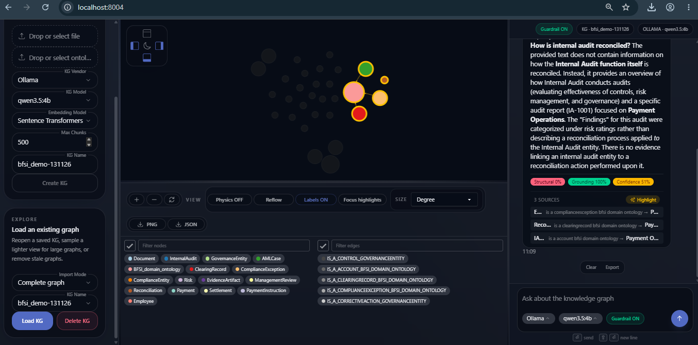

# OntoGraphRAG
OntoGraphRAG is an ontology-guided Knowledge Graph Retrieval-Augmented Generation (KG-RAG) framework developed by Sahib Julka.

Unlike conventional RAG architectures that primarily retrieve semantically similar document chunks, OntoGraphRAG constructs structured knowledge graphs from unstructured documents and uses graph relationships alongside vector-based retrieval.

OntographRAG combines Large Language Models (LLMs), ontology-guided information extraction, knowledge graphs, vector embeddings, and hybrid retrieval to improve the reliability and explainability of Retrieval-Augmented Generation systems.The framework also introduces answer-level trust signals to help evaluate whether generated responses are structurally supported by the knowledge graph and grounded in retrieved evidence.

## OntographRAG framework
The framework consists of two major pipelines:
- Knowledge Graph Construction
- Graph-Augmented Retrieval and Answer Generation

[](https://mermaid.live/edit#pako:eNpt011v2jAUBuC_YvlqkxKUNJA2uZhUPgqsQOnXLub0wo0PidfErk6cFob471MMoWPr5bGe8x7rWN7SVAugMV0V-j3NORryMEwwUYQQcskeVWWwTk2NIMhQp3UJylRPxHW_kT5rD8hUZVAZqdVT29q3ZPBBBnmtXqTKjmJgxZDdKKMLnW3ITHPxNxhaMGKz2dzt8woEGSkjzYZwJcgdFLwZSEZrgzw9mT2yjVfswCccS61kxU_QlUVjtkT9BoqrFMgD8vTkimNrJmxUPoNo7kbGoABPgyYWTdmXBejuL3Kt9HsBIgMyRv6af7Wutd_ZYwVIbuvDtmzrdXvRqQBl5EqmpwOurZoxm3fYxB0YlPDGi3_UnP2A1Gj8BEz3MW05s-WCTTbPKAUZvUkBzRL-b5zvZVsubHnDjh33G2VyqGR17LixZNm8HLlU1TvgZ4tbWnXLxqhrJUC0tHneB6wrQ-5lpnhRPVGHZigFjVe8qMChJWDJm5pum6iEmhxKSGhMEoog6rUrOL64qS40JjRRO-rQV65-al3S2GANDkVdZ_kxsH4V3MBQ8gz5BwElAAe6VobGXZtA4y1d0ziIwk734sKLumEYdX3v_NyhGxq7vt_xvCC68M7OvMALev7Oob_tUL_jhaEfnff8bi8IoigMHQpCGo3z_fezv3D3B0WhISM)
<!--  -->

### Knowledge graph Construction
The knowledge graph generation pipeline transforms raw documents into structured graph representations.

Main stages:
- **Document ingestion:** Load PDF, TXT, CSV, JSON, or XML files.
- **Chunking:** Divide documents into manageable extraction and retrieval units.
- **Ontology loading:** Load an ontology or schema to define permitted entity and relationship types.
- **Information extraction:** Use LLMs to extract entities and relationships.
- **Cross-chunk relationship extraction:** Identify relationships across document sections.
- **Entity harmonisation:** Merge synonyms and resolve inconsistent entity representations.
- **Provenance tracking:** Associate extracted knowledge with its source.
- **Embedding generation:** Generate vector representations for retrieval.
- **Graph persistence:** Store the resulting graph in Neo4j.

### Graph-Augmented Retrieval
When a user submits a question, OntoGraphRAG performs several retrieval operations.
- Entity-first retrieval identifies relevant entities.
- Graph traversal explores connected entities and relationships.
- Provenance-aware retrieval prioritises source-supported relationships.
- Graph scoring identifies useful contextual evidence.
- Vector retrieval provides semantic fallback and additional context.
- Evidence synthesis organises retrieved information for answer generation.

The resulting evidence is passed to an LLM to generate an answer.

**Web UI** served at `http://localhost:8004`.
- **Build KG** — upload a document, pick provider/model, optionally attach an
  ontology.
- **Graph view** — interactive force-directed network with node details,
  search (dims non-matches), and per-type filters.
- **Named KGs** — create, list, and switch between saved graphs.
- **Chat** — answers cite source chunks, highlight the entities used. 
Chat also shows **Trust and Grounding Signals** through structural and grounding support. These signals help distinguish structural consistency from actual evidence grounding.
  - ***Structural Support:***	Measures support for an answer through relevant knowledge-graph paths.
  - ***Grounding Support***	Measures whether retrieved evidence supports the generated answer.

The framework supports multiple model providers:
- OpenAI
- Google Gemini
- OpenRouter
- DeepSeek
- Hugging Face
- Ollama (local models): I have used Ollama with qwen3.5:4b for demo



**Video:**

<video width="720" height="540" controls>
  <source src="./OntographRAG%20UI%20BFSI%20demo.mp4" type="video/mp4">
</video>

## Installation
### Requirements
- Python 3.11 or later
- Neo4j 5.0 or later
- An API key from a supported LLM provider, or a configured local Ollama instance
- Node.js 18 or later for frontend development from source
- Docker (optional)

```bash
# Install from PyPI
python -m pip install ontographrag

# Or install the latest source snapshot from GitHub
python -m pip install "ontographrag @ git+https://github.com/julka01/OntoGraphRAG.git"

# Change Directory
cd OntoGraphRAG

# Run Neo4j using Docker (if docker is installed):
# If Neo4j version is >5 or 2026.10, use that version number
docker run -d \
  --name ontographrag-neo4j \
  -p 7474:7474 \
  -p 7687:7687 \
  -e NEO4J_AUTH=neo4j/password \
  neo4j:5                                   

# Configure in .env.example
export NEO4J_URI=neo4j//localhost:7687 NEO4J_USERNAME=neo4j NEO4J_PASSWORD=password

# Copy the example environment file:
# For Linux users
cp .env.example .env  

# For Windows users
Copy-Item .env.example .env  

# Launch the web app
python -m ontographrag.cli serve                  # → http://localhost:8004
```

## File structure
```bash
OntoGraphRAG/
│
├── ontographrag/
│   ├── api/
│   │   └── app.py
│   ├── kg/
│   │   ├── builders/
│   │   ├── loaders/
│   │   └── utilities/
│   ├── rag/
│   │   ├── systems/
│   ├── schemas/
│   │   └── models.py
│   ├── providers/
│   │   └── model_providers.py
│   └── cli.py
├── frontend/               #→ React + TypeScript application
├── experiments/
├── reproducibility/
│   └── arxiv_v1/
├── scripts/
├── tests/
├── log_results/           #→ This directory contains all the json of created Knowledge graph and markdown files of all the chat queries and retrieval
├── synthetic datasets/  #This directory contains all the text data generated using ChatGPT and Ontology JSON file
├── KG_GENERATION_PIPELINE.md
├── EVALUATION_METRICS.md
├── README.md
├── CHANGELOG.md
├── bfsi_ontographrag_fixed.py #The code is used to convert Neosemantics JSON of Neo4j to JSON compatible for OntographRAG
├── requirements.txt  #Use if python is 3.11 or 3.12 else use requirements_mod.txt
├── pyproject.toml
├── docker-compose.yml
├── Dockerfile
├── OntographRAG UI BFSI demo.mp4
├── .env.example
├── .env
└── LICENSE
```

## License
MIT — see [LICENSE](LICENSE). Issues:
[GitHub Issues](https://github.com/julka01/OntoGraphRAG/issues).

## Citation
```bibtex
@article{julka2026ontographrag,
  title={When Answer Agreement Fails:
         Retrieval-State Lock-In in Retrieval-Augmented Generation},
  author={Julka, Sahib},
  journal={arXiv preprint},
  year={2026}
}
```
